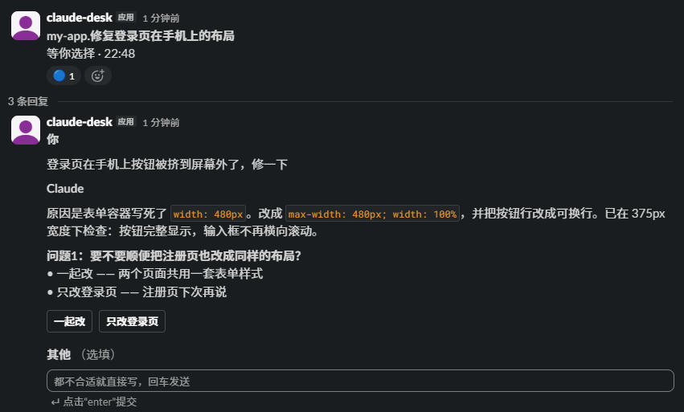

# claude-slack-bridge

[](https://github.com/omiyeong/claude-slack-bridge/actions/workflows/check.yml)
[](LICENSE)


[中文](README.md) | English

Relay Claude desktop app sessions (Code tab) to Slack DMs. When a session stops, asks a question or needs a permission, it shows up in Slack; reply in the thread and the text is typed back into the same session on your PC. Walk away, keep working.

Windows only. Pure Windows PowerShell 5.1 and .NET Framework, no dependencies to install.

> Personal project. Not affiliated with Anthropic or Slack.

<p align="center"></p>

## Features

- **Auto relay when you're away**: after a period with no keyboard/mouse input (5 minutes by default), session stops, questions and permission requests go to your Slack DM, one thread per session.
- **`/slack` on demand**: type `/slack` in a session to open a new thread with its last 5 messages; from then on every stop of that session is relayed, whether you're at the PC or not.
- **Reply from Slack**: thread replies are pasted into the right session. If the session is busy the reply is queued (⏳) and marked ✅ once delivered.
- **Buttons**: answer questions (single, multi, free text) and allow/deny tool permissions right in Slack.
- **`列表` (list)**: send `列表` in the DM (outside any thread) to list every session waiting for you.

Thread titles are `project.session-title`; sessions without a folder show just the title, worktree sessions use their repository name.

## How it works

```
Claude desktop ──hooks──▶ spool dir ──▶ listener (resident) ◀──Socket Mode──▶ Slack
       ▲                                     │
       └──────── open session, paste, Enter ◀┘
```

- Hooks only write events to a spool directory; they never call Slack and never slow the session down.
- The listener is the only process talking to Slack, over Socket Mode, so no public endpoint is needed.
- Questions and permissions go through the `PermissionRequest` hook, which blocks for up to 9 minutes waiting for your Slack answer, then falls back to the desktop dialog.
- Before typing, the listener waits until you've been idle for 30 s and checks the session has no open dialog.

## Requirements

- Windows 10 1809+ or Windows 11
- Claude desktop app, sessions in the Code tab
- A Slack workspace where you can create apps (free plan is fine)

## Install

1. **Create the Slack app**: Create New App → From a manifest, paste `manifest.yml`, install to your workspace.
2. **Tokens**: the Bot Token (`xoxb-`) from OAuth & Permissions; an App-Level Token (`xapp-`) with `connections:write` from Basic Information.
3. **Config**: copy `.env.example` to `%USERPROFILE%\.claude-slack-bridge\.env` and fill in both tokens and your own Slack member ID.
4. **Register the background task and `/slack`**:

   ```powershell
   powershell -NoProfile -ExecutionPolicy Bypass -File .\install.ps1 -RegisterTask
   ```

   This registers the logon task `claude-slack-bridge` (hosted by headless `conhost`, no window), installs `/slack` into `~/.claude/commands`, and prints the hooks config.

5. **Hooks**: merge the printed `Stop` / `PermissionRequest` / `Notification` / `UserPromptSubmit` entries into `hooks` in `~/.claude/settings.json`.
6. **Start**:

   ```powershell
   Start-ScheduledTask claude-slack-bridge
   ```

   `%USERPROFILE%\.claude-slack-bridge\logs\listener.log` should show `Socket Mode 已连接` (connected). Type `/slack` in any session and its thread should appear in your DM.

## Configuration

Optional keys in `.env`:

| Key | Default | Meaning |
|---|---|---|
| `AWAY_AFTER_SECONDS` | 300 | Idle seconds before you count as away |
| `INJECT_IDLE_SECONDS` | 30 | Idle seconds required before typing into a session |

Runtime data (state, spool, pending questions, logs) lives in `%USERPROFILE%\.claude-slack-bridge\`.

## Uninstall

```powershell
Unregister-ScheduledTask claude-slack-bridge -Confirm:$false
```

```powershell
Remove-Item "$env:USERPROFILE\.claude\commands\slack.md"
```

Then remove the four hooks pointing at `hook.ps1` from `~/.claude/settings.json`, and delete `%USERPROFILE%\.claude-slack-bridge\` if you no longer need the data.

## Known limitations

- Only desktop app sessions are relayed; `claude` in a terminal is ignored.
- Question/permission buttons expire after 9 minutes; after that, handle it at the PC.
- Slack turns straight quotes into curly ones; wrap commands in backticks to send them verbatim.
- Following started by `/slack` can't be turned off yet.
- Typing brings the desktop app to the foreground and borrows the clipboard briefly (restored afterwards).
- Messages and docs are in Chinese.

## Contributing

Issues and PRs welcome. See [CONTRIBUTING.md](CONTRIBUTING.md), report security issues per [SECURITY.md](SECURITY.md), changes in [CHANGELOG.md](CHANGELOG.md).

## License

[MIT](LICENSE)
