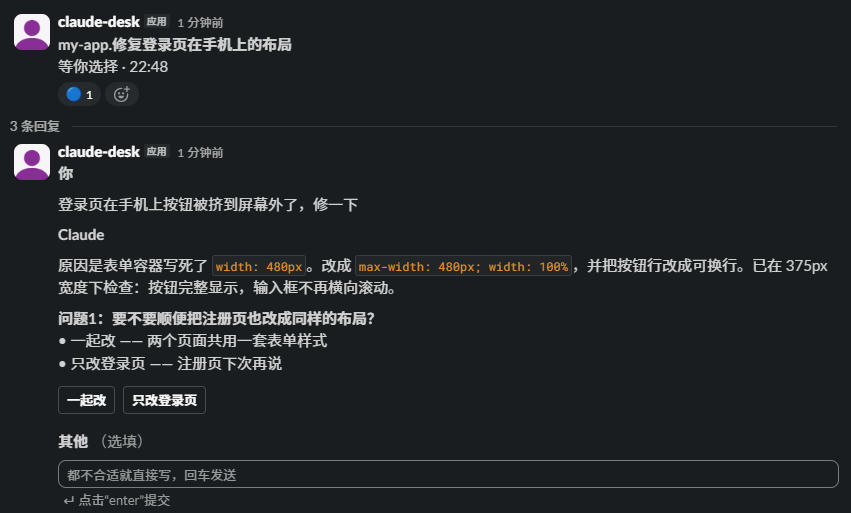

# claude-slack-bridge

[](https://github.com/omiyeong/claude-slack-bridge/actions/workflows/check.yml)
[](LICENSE)


中文 | [English](README.en.md)

把 Claude 桌面应用（Code 标签页）里的会话接到 Slack 私信：会话停下、要你选择或授权时发到 Slack，你在 Slack thread 里回复，文字会打回电脑上同一个会话。人离开电脑，活不停。

只支持 Windows，全部用系统自带的 PowerShell 5.1 和 .NET Framework，不装任何依赖。

> 这是个人项目，不是 Anthropic 或 Slack 的官方产品。

<p align="center"></p>

## 能做什么

- **离开电脑时自动发**：一段时间没有键盘鼠标操作（默认 5 分钟），会话停下、选择题、授权请求会发到 Slack 私信，每个会话一个 thread。
- **`/slack` 手动发**：在会话里输入 `/slack`，新开一个 thread，发最近 5 条消息；之后这个会话不管你在不在电脑前，停下都会发过去。
- **在 Slack 里回复**：thread 里回的文字会切到对应会话、粘贴、回车。会话正在跑时回复会排队，消息上先显示 ⏳，会话收到后变 ✅。
- **按钮作答**：选择题（单选、多选、自己填）和工具授权（允许 / 拒绝）直接在 Slack 里点。
- **`列表`**：在私信里（不在 thread 里）发 `列表`，列出所有在等你的会话和链接。

thread 标题是 `项目.会话名`；没选文件夹的会话只显示会话名，worktree 里的会话显示所在仓库名。

## 工作方式

```
Claude 桌面应用 ──hook──▶ spool 目录 ──▶ listener（常驻）◀──Socket Mode──▶ Slack
        ▲                                     │
        └──────────── 切会话、粘贴、回车 ◀──────┘
```

- hook 只把事件写进 spool，不连 Slack，不拖慢会话。
- listener 是唯一连 Slack 的进程，用 Socket Mode，不需要公网地址。它负责发消息、收回复、往会话里打字、处理按钮。
- 选择题和授权走 `PermissionRequest` hook：hook 阻塞等 Slack 里的答案，9 分钟没答就交回桌面应用自己的弹窗。
- 往会话打字前会确认你至少 30 秒没动键鼠，而且这个会话没有开着的弹窗，免得和你抢键盘、把字打进弹窗。

| 文件 | 作用 |
|---|---|
| `hook.ps1` | hook 入口：`stop` / `permission` / `notification` / `prompt`，只写 spool |
| `listener.ps1` | 常驻进程：发通知、收回复、打字、处理按钮 |
| `run-listener.ps1` | 计划任务入口，listener 退出后 10 秒重启 |
| `lib\common.ps1` | 路径、JSON、配置、空闲时间、transcript 读取 |
| `lib\slack.ps1` | Slack Web API 和 Socket Mode |
| `lib\inject.ps1` | 打开指定会话、粘贴、回车 |
| `commands\slack.md` | `/slack` 命令定义，由 `install.ps1` 装到 `~/.claude/commands` |
| `manifest.yml` | Slack 应用清单 |
| `install.ps1` | 注册计划任务、安装 `/slack`、打印 hooks 配置 |
| `tools\check.ps1` | 提交前检查：脚本能解析、带 BOM，CI 也跑它 |

## 环境要求

- Windows 10 1809 及以上或 Windows 11（自带 PowerShell 5.1 和无头 `conhost`）
- Claude 桌面应用，会话在 Code 标签页里跑
- 一个能自己建应用的 Slack 工作区（免费版就行）

## 安装

1. **建 Slack 应用**：Slack 后台 → Create New App → From a manifest，粘贴 `manifest.yml`，安装到工作区。
2. **拿 token**：OAuth & Permissions 页的 Bot Token（`xoxb-`）；Basic Information → App-Level Tokens 生成一个带 `connections:write` 的 token（`xapp-`）。
3. **填配置**：把 `.env.example` 复制成 `%USERPROFILE%\.claude-slack-bridge\.env`，填两个 token 和你自己的 Slack 用户 ID（个人资料 → 更多 → 复制成员 ID）。
4. **注册后台运行并安装 `/slack`**：

   ```powershell
   powershell -NoProfile -ExecutionPolicy Bypass -File .\install.ps1 -RegisterTask
   ```

   它会注册登录时启动的计划任务 `claude-slack-bridge`（用无头 `conhost` 托管，没有窗口），把 `/slack` 装到 `~/.claude/commands`，并打印 hooks 配置。

5. **配 hooks**：把打印出来的 `Stop` / `PermissionRequest` / `Notification` / `UserPromptSubmit` 合并进 `~/.claude/settings.json` 的 `hooks`，保留已有条目。
6. **启动并确认**：

   ```powershell
   Start-ScheduledTask claude-slack-bridge
   ```

   `%USERPROFILE%\.claude-slack-bridge\logs\listener.log` 里出现“Socket Mode 已连接”就好了。在任一会话里输入 `/slack`，Slack 私信里应出现这个会话的 thread。

## 配置

`.env` 里的可选项：

| 项 | 默认 | 含义 |
|---|---|---|
| `AWAY_AFTER_SECONDS` | 300 | 多少秒没有键鼠操作算离开电脑 |
| `INJECT_IDLE_SECONDS` | 30 | 往会话打字前，要求至少多少秒没有键鼠操作 |

运行数据（状态、spool、待答问题、日志）都在 `%USERPROFILE%\.claude-slack-bridge\`，不进仓库。

## 改代码后重启

```powershell
Get-CimInstance Win32_Process -Filter "Name='powershell.exe'" | Where-Object { $_.CommandLine -match 'run-listener\.ps1|listener\.ps1' } | ForEach-Object { Stop-Process -Id $_.ProcessId -Force }
```

```powershell
Start-ScheduledTask claude-slack-bridge
```

不要直接在终端里跑 `listener.ps1` 常驻：默认终端是 Windows Terminal 时它是个可见窗口，关掉就停了。

## 排查

| 现象 | 看哪里 |
|---|---|
| Slack 什么都收不到 | `listener.log` 最后有没有“Socket Mode 已连接”；`spool` 目录里堆着事件说明 listener 没在跑 |
| `/slack` 被当成普通消息发给了 Claude | `settings.json` 里没有 `UserPromptSubmit` hook，或 hook 里 `hook.ps1` 的路径不对 |
| 回复显示 ⚠️ 没送达 | thread 里的说明；多半是会话有弹窗没处理，或桌面应用没开 |
| hook 报错 | `hook.log` |

日志都在 `%USERPROFILE%\.claude-slack-bridge\logs\`。

## 卸载

```powershell
Unregister-ScheduledTask claude-slack-bridge -Confirm:$false
```

```powershell
Remove-Item "$env:USERPROFILE\.claude\commands\slack.md"
```

再从 `~/.claude/settings.json` 删掉指向 `hook.ps1` 的四个 hook。运行数据在 `%USERPROFILE%\.claude-slack-bridge\`，不要了就整个删掉。

## 已知限制

- 只处理桌面应用里的会话；终端里的 `claude` 会话不会发。
- 选择题和授权的按钮只等 9 分钟，超时后只能到电脑上处理；处理前这个会话的 Slack 回复不会打进去。
- Slack 输入框会把直引号改成弯引号，要原样发命令时用反引号包起来。
- `/slack` 开始的跟随目前没有关闭的办法。
- 打字靠切窗口和剪贴板：打字那一刻桌面应用会被切到前台，剪贴板会被临时占用后还原。

## 参与

欢迎 issue 和 PR，先看 [CONTRIBUTING.md](CONTRIBUTING.md)。安全问题请按 [SECURITY.md](SECURITY.md) 私下报告。版本变化见 [CHANGELOG.md](CHANGELOG.md)。

## License

[MIT](LICENSE)
